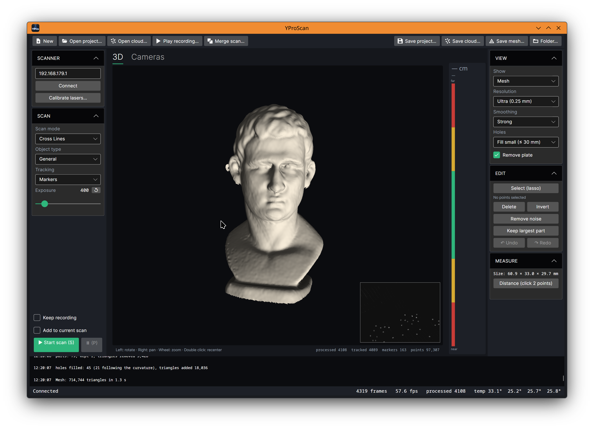

# YProScan

**3D scanning on Linux for the Revopoint MetroY Pro.**

YProScan is a free Linux app that connects to the Revopoint MetroY Pro over its own Wi-Fi network, scans, and turns the
result into a point cloud or a mesh, without Windows or a virtual machine.

> **Status: alpha.** It works well on the developer's scanner, but it has not been tested on any other unit yet.
> It is developed and tested on **CachyOS** (Arch-based). Other distributions, the `.deb` and the AppImage outside
> CachyOS have not been tried yet: **feedback is very welcome**.
> We are looking for **beta testers** with a MetroY Pro and a Linux PC: see [Become a beta tester](#become-a-beta-tester).

## Why

I moved from Windows to CachyOS, and the only way left to use my MetroY Pro was the Revopoint software on my
M5 Pro Mac, through Rosetta. So I wrote my own Linux app, with the help of Claude. YProScan is the result: I use it
every day, and I'm sharing it for free with anyone in the same situation.

> YProScan is an independent project. It is **not affiliated with, endorsed by or supported by Revopoint**.
> Revopoint, MetroY and Revo Metro are trademarks of their owners. Do not ask Revopoint for support about this app.

---

## What it does

**Scan modes**

| Mode | Tracking | Notes |
|---|---|---|
| Cross Lines | markers | the most detailed mode |
| Parallel Lines | markers | |
| Single Line | markers | for deep, narrow details |
| Full Field | **no markers needed** (follows the shape and the texture of the object) or markers | quick, less detailed |

- Object types: General, Dark and Shiny, with an exposure slider.
- Live 3D view while scanning, with a camera preview and a red border when tracking is lost.
- Pause and resume (key **P**), start and stop (key **S**).
- Add a second pass to the same scan, or merge two scans of the same object automatically.

**After the scan**

- Point cloud or mesh view, resolution down to 0.25 mm.
- Hole filling that follows the surrounding curvature, or a fully closed (watertight) mesh for 3D printing.
- Remove the plate under the object, lasso selection, noise removal, keep the largest part, undo and redo.
- Size and point-to-point distance measurements.
- Export: point cloud **PLY**, mesh **STL** and **OBJ**.
- Save and reopen a scan as a small project file.

**Laser calibration**

Each MetroY Pro has its own laser geometry. YProScan measures it with the **ceramic calibration board that comes with
the scanner**: press *Calibrate lasers…*, move the scanner over the board for about a minute, done.
Each scan mode (Cross, Parallel, Single) is calibrated once; the result is saved for that scanner.

## What it does not do (yet)

- No colour or texture.
- No MetroY (non-Pro), MetroY Ultra, MetroX or other Revopoint scanners: only the **MetroY Pro**, over **Wi-Fi**.
- No USB connection.
- No firmware updates, and it never will: use Revopoint's software for that.
- Full Field scanning without markers can lose tracking on plain, flat or round objects, or if you move fast.

## Requirements

| | |
|---|---|
| Scanner | Revopoint **MetroY Pro**, with its ceramic calibration board |
| System | Linux **x86-64**. Tested on CachyOS; other distributions should work but are untested |
| Wi-Fi | a **5 GHz** Wi-Fi adapter. The PC joins the scanner's own network (`MetroYPro-REVO-…`); use a cable for your normal network if you can |
| CPU / RAM | a recent multi-core CPU; **16 GB RAM** recommended (a long high-detail Full Field scan can use 4 GB or more) |
| Graphics | nothing special: the 3D view does not need a GPU |
| Libraries | **GTK 3**, present on almost every Linux desktop (`gtk3` / `libgtk-3-0`) |

No .NET or other runtime to install: everything is in the download.

### Wi-Fi tips

- Some USB Wi-Fi adapters pause the connection every few seconds to look for other networks. During a scan this shows
  up as the tracking stopping for a second or two. If it happens, see [Wi-Fi pauses](#wi-fi-pauses-during-the-scan).
- Signal is rarely the problem: the scanner is a few centimetres to a metre away.

## Install

Download one of these from **[Releases](https://github.com/RenatoTarabella/YProScan/releases)**. They contain the same app.

| File | For | How |
|---|---|---|
| `yproscan_<version>_amd64.deb` | Debian, Ubuntu, Mint, Pop!_OS | `sudo apt install ./yproscan_<version>_amd64.deb`, then open YProScan from the menu |
| `YProScan-<version>-x86_64.AppImage` | any distribution (Fedora, Arch, openSUSE…) | make it executable (`chmod +x`) and double-click it |
| `YProScan-<version>-linux-x64.tar.gz` | if the others don't suit you | extract it, run `./YProScan`; `./install-launcher.sh` adds it to the menu |

- The **AppImage** needs **libfuse2** to start with a double click. Recent Debian and Ubuntu no longer install it by
  default: there, use the `.deb`, or install `libfuse2` (`libfuse2t64` on Ubuntu 24.04 and later).
- The first start takes a few seconds longer: the app unpacks its libraries into `~/.net`.
- Each file has a `.sha256` next to it, to check the download: `sha256sum -c <file>.sha256`.

To remove it: `sudo apt remove yproscan` for the `.deb`; for the others, delete the file or the folder.
Settings and logs are in `~/.config/YProScan` and `~/.cache/YProScan`.

## First scan

1. Turn the scanner on and join its Wi-Fi network (`MetroYPro-REVO-…`, no password).
2. Open YProScan and press **Connect**. The app downloads the camera calibration from the scanner.
3. **Calibrate the lasers** once: choose *Cross Lines*, press *Calibrate lasers…* and follow the instructions with the
   ceramic board. Repeat for Parallel and Single Line if you use them.
4. Put markers around the object, choose the mode and the object type, and press **Start scan** (or **S**).
5. Move slowly. When the border turns red, go back to an area you already scanned.
6. Press **Stop**: the scan is optimised in a few seconds. Switch the view to *Mesh*, fill the holes, and use
   *Save mesh…* or *Save project…*.

## Become a beta tester

We need people with a **MetroY Pro** and a **Linux PC** who can spend an hour scanning and reporting back.
What helps most, in order:

1. **Calibration on your scanner.** This is the big unknown: does *Calibrate lasers…* find all the lasers on your unit,
   and what score does it give? (It shows the number of lasers found and the depth error in mm.)
2. **A first scan in Cross Lines** with markers, on any object, and a screenshot of the result.
3. **Full Field without markers** on an object with some shape and texture.
4. Anything that breaks: crashes, freezes, the scanner not connecting, strange results.

**How to report:** open an **[Issue](https://github.com/RenatoTarabella/YProScan/issues)** and attach:

- your Linux distribution and Wi-Fi adapter model;
- the log file `~/.cache/YProScan/app.log`. It contains settings, timings, results, and the names and folders of
  your scans: have a look before sharing it if those are private;
- a screenshot, if it is about something you see.

If the developer needs to look at a specific scan, you can turn on **Keep recording** before scanning: the raw frames are
saved and can be played back. They are large (300–550 MB per minute), so only send them when asked.

## Troubleshooting

### The scanner does not connect

- Check that the PC is on the scanner's Wi-Fi network, not on your home network.
- The scanner's address is `192.168.179.1`; it must answer `ping 192.168.179.1`.
- If you have a firewall, allow the connection to that address.

### Full Field shows almost no depth

After several Full Field scans in a row the scanner sometimes gets out of sync: the depth preview stays almost black.
Turn the scanner off and on again. (We are still looking for the cause.)

### Wi-Fi pauses during the scan

The log shows lines like `stream gap 1.5 s`. Your Wi-Fi adapter or NetworkManager is scanning for other networks
during the scan. Close the network applet while scanning; for some Realtek adapters a driver option helps. Open an
issue with your adapter model and we will try to help.

## Licence

YProScan is **free for everyone, including commercial use**: scan for yourself, for your business or for your
customers. It is **not open source**: the source code is not published. You may not sell it, bundle it in something
you sell, or distribute modified copies. The scans you make are yours. Full text: [LICENSE.txt](LICENSE.txt).

It uses [Avalonia](https://avaloniaui.net/) (MIT licence) and [OpenCvSharp](https://github.com/shimat/opencvsharp)
(Apache 2.0); their licence texts are in the `licenses` folder of the download.

The software is provided **as is**, without warranty. Scanning involves laser light: follow the safety instructions
that came with your scanner.

## Credits

Parts of YProScan were written and optimised with the help of Claude (Fable 5.2 and Opus 5.5) by Anthropic.
